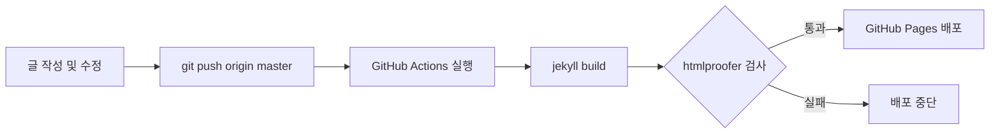

> 이 블로그가 어떻게 만들어져 있고 어떻게 굴러가는지 잊어버렸을 때 가장 먼저 다시 읽는 글이다.

이 블로그는 Jekyll 테마인 [**Chirpy**][chirpy]를 **포크(fork)** 해서 만들었다.

가이드는 모두 5편이며, 새 글을 쓸 때마다 참고하는 것을 전제로 작성했다.

| 순서 | 글 | 언제 읽는가 |
| :--: | :-- | :-- |
| 1 | 프로젝트 구조와 운영 (이 글) | 블로그의 구조·배포·업데이트 방법이 궁금할 때 |
| 2 | [포스트 작성 규칙과 Front Matter](/posts/chirpy-guide-2-writing-posts/) | 새 글을 쓰기 시작할 때 |
| 3 | [마크다운 문법 레퍼런스](/posts/chirpy-guide-3-markdown-syntax/) | 본문을 쓰다가 문법이 기억나지 않을 때 |
| 4 | [이미지와 미디어](/posts/chirpy-guide-4-images-and-media/) | 이미지·영상·오디오를 넣을 때 |
| 5 | [사이트 설정과 커스터마이징](/posts/chirpy-guide-5-site-settings/) | 블로그 자체의 설정이나 모양을 바꿀 때 |

---

## 1. 프로젝트 개요

| 항목 | 내용 |
| :-- | :-- |
| 테마 | Chirpy `v7.6.0` (Jekyll `~> 4.3`) |
| 블로그 저장소 | `home-pay9um/home-pay9um.github.io` — 원본 `cotes2020/jekyll-theme-chirpy`의 포크 |
| 기본 브랜치 | `master` |
| 사이트 주소 | <https://home-pay9um.github.io> |
| 배포 방식 | `master`에 push → GitHub Actions가 빌드 → GitHub Pages에 배포 |
| 미디어 저장소 | `home-pay9um/assets` (`main` 브랜치) — 이미지 전용 저장소, CDN처럼 사용 |

글은 블로그 저장소에, 이미지는 미디어 저장소에 나누어 관리한다는 점이 이 블로그의 가장 큰 특징이다.

---

## 2. 포크 방식이라는 것의 의미

Chirpy로 블로그를 만드는 방법은 두 가지가 있다.

| 방식 | 저장소에 들어 있는 것 | 테마 업데이트 |
| :-- | :-- | :-- |
| Starter | 글과 설정뿐. 테마는 gem으로 설치 | gem 버전만 올리면 됨 |
| **Fork (이 블로그)** | 글과 설정 + **테마 소스 전체** | Git 병합으로 직접 가져와야 함 |

포크 방식이기 때문에 다음과 같은 특징이 생긴다.

- `_layouts`, `_includes`, `_sass`, `_javascript`가 저장소에 있어 테마를 직접 고칠 수 있다.
- `Gemfile`의 `gemspec` 한 줄 때문에 **이 저장소 자체가 `jekyll-theme-chirpy` gem 역할**을 한다. `_config.yml`의 `theme: jekyll-theme-chirpy`는 외부 gem이 아니라 이 저장소 자신을 가리킨다.
- 원본이 업데이트되어도 **자동으로 따라오지 않는다.** 직접 병합해야 한다. ([7장](#upstream) 참고)
- 테마 파일을 많이 고칠수록 병합할 때 충돌이 늘어난다.

---

## 3. 디렉터리 구조

```text
home-pay9um.github.io/
├── _config.yml          # 사이트 전체 설정 (제목, URL, CDN, 댓글 등)
├── _posts/              # ★ 글. 평소에 손대는 곳은 사실상 여기뿐이다
├── _tabs/               # 사이드바 탭 페이지 (About, Archives, Categories, Tags)
├── _data/               # 데이터 파일
│   ├── authors.yml      #   작성자 정보
│   ├── contact.yml      #   사이드바 하단 연락처 아이콘
│   ├── share.yml        #   글 하단 공유 버튼
│   ├── media.yml        #   영상·오디오 확장자와 MIME 타입
│   ├── locales/         #   UI 문구 번역 (ko-KR.yml 포함)
│   └── origin/          #   외부 라이브러리 CDN 주소
├── _layouts/            # 페이지 뼈대 (home, post, page, category, tag ...)
├── _includes/           # 레이아웃이 조립해서 쓰는 조각 (sidebar, toc, embed/ ...)
├── _sass/               # 스타일 원본 (SCSS)
├── _javascript/         # 스크립트 원본
├── _plugins/            # Jekyll 플러그인 (글의 마지막 수정일 자동 계산)
├── assets/
│   ├── css/             #   SCSS 진입점
│   ├── img/favicons/    #   파비콘
│   ├── js/dist/         #   _javascript 를 빌드한 결과물 (*.min.js)
│   ├── js/data/         #   mathjax.js, search.json, swconf.js
│   └── lib/             #   정적 자산 서브모듈 (self-host 할 때만 사용)
├── tools/               # run.sh (로컬 서버), test.sh (빌드 + 링크 검사)
├── .github/workflows/   # pages-deploy.yml (배포 자동화)
├── Gemfile              # Ruby 의존성
└── package.json         # JS/CSS 빌드 도구 (테마를 고칠 때만 필요)
```
{: .nolineno }

수정 빈도로 나누면 다음과 같다.

| 구분 | 경로 | 비고 |
| :-- | :-- | :-- |
| 자주 | `_posts/` | 글 작성 |
| 가끔 | `_config.yml`, `_tabs/about.md`, `_data/contact.yml`, `_data/share.yml`, `assets/img/favicons/` | 사이트 설정 |
| 필요할 때만 | `_layouts/`, `_includes/`, `_sass/`, `_javascript/` | 테마 자체 수정. 원본 병합 시 충돌의 원인이 된다 |
| 건드리지 않음 | `_site/`, `.jekyll-cache/`, `node_modules/`, `Gemfile.lock` | 빌드 산출물과 캐시. `.gitignore` 대상 |

---

## 4. 원본 대비 달라진 점

포크 직후 `tools/init.sh`를 실행해 저장소를 블로그용으로 초기화했다. 이 스크립트가 한 일은 다음과 같다.

- `.github/workflows/starter/pages-deploy.yml`을 `.github/workflows/pages-deploy.yml`로 옮겨 배포 워크플로를 활성화
- 테마 개발용 워크플로(CI, 린트, 릴리스 등)와 이슈·PR 템플릿, `tools/init.sh`, `tools/release.sh` 삭제
- `.gitignore`에서 `_sass/vendors`, `assets/js/dist` 제외 규칙을 제거하고 **빌드 결과물을 저장소에 커밋**
- 원본의 예제 글(`_posts/2019-08-*.md`) 삭제

그 외에 직접 바꾼 것은 다음 두 가지뿐이다.

- `_config.yml`: `timezone`, `title`, `tagline`, `description`, `url`, `github.username`, `twitter.username`, `social`, `cdn`, `avatar`
- `assets/img/favicons/`: 파비콘 교체

> `assets/js/dist/`와 `_sass/vendors/`가 저장소에 커밋되어 있다는 점을 기억해야 한다.
>
> 원본 저장소는 이 두 경로를 Git으로 추적하지 않는다. 그래서 원본의 `_javascript/` 변경을 병합해도 **빌드 결과물은 자동으로 갱신되지 않는다.** 병합 후에는 반드시 다시 빌드해야 한다. ([7장](#upstream) 참고)
{: .prompt-warning }

---

## 5. 로컬에서 실행하기

### 5.1 준비물

| 도구 | 용도 | 비고 |
| :-- | :-- | :-- |
| Ruby | Jekyll 실행 | `~> 3.1` 필요. 배포 워크플로는 3.4를 사용한다 |
| Bundler | Ruby 의존성 설치 | `gem install bundler` |
| Git | 버전 관리, 수정일 계산 | — |
| Node.js | 테마의 JS/CSS 재빌드 | 테마를 고치거나 원본을 병합할 때만 필요 |

### 5.2 미리보기 서버

```bash
bundle install            # 최초 1회, 또는 Gemfile·gemspec이 바뀐 뒤
bundle exec jekyll serve  # http://127.0.0.1:4000
```

- 파일을 저장하면 자동으로 다시 빌드된다. 단, `_config.yml`은 예외라서 **서버를 재시작해야** 반영된다.
- `bash tools/run.sh`를 쓰면 브라우저 자동 새로고침(live reload)까지 켜진다.
- 초안까지 보려면 `--drafts`, 미래 날짜의 글까지 보려면 `--future` 옵션을 붙인다.

> 이미지는 로컬 미리보기에서도 미디어 저장소(CDN)에서 불러온다.
>
> 아직 push하지 않은 이미지는 로컬에서도 보이지 않는다. 자세한 내용은 [4편](/posts/chirpy-guide-4-images-and-media/)에서 다룬다.
{: .prompt-info }

### 5.3 배포 전 검사

```bash
bash tools/test.sh
```

프로덕션 모드로 사이트를 빌드한 뒤 `htmlproofer`로 내부 링크를 검사한다. 배포 워크플로가 하는 검사와 같으므로, **여기서 통과하면 배포도 통과한다.**

Windows에서는 Git Bash에서 실행한다.

> Windows에서는 검사 단계에서 `Could not open library 'libcurl'` 오류가 날 수 있다. `htmlproofer`가 사용하는 `libcurl.dll`을 Ruby가 찾지 못해서 생기는 문제이다.
>
> Git for Windows에 들어 있는 파일을 복사해서 한 번만 준비해 둔다.
>
> ```bash
> mkdir -p ~/.libcurl
> cp "/c/Program Files/Git/mingw64/bin/libcurl-4.dll" ~/.libcurl/libcurl.dll
> ```
>
> 그다음부터는 `RUBY_DLL_PATH`를 지정해서 실행한다.
>
> ```bash
> RUBY_DLL_PATH="$(cygpath -w ~/.libcurl);C:\Program Files\Git\mingw64\bin" bash tools/test.sh
> ```
>
> 준비하지 않았다면 `JEKYLL_ENV=production bundle exec jekyll build`로 빌드 오류만 확인하고, 링크 검사는 push 후 GitHub Actions의 결과로 확인한다.
{: .prompt-info }

---

## 6. 배포 흐름



| 단계 | 내용 |
| :-- | :-- |
| 트리거 | `master`(또는 `main`)에 push. `.gitignore`, `README.md`, `LICENSE`만 바뀐 push는 무시한다. 저장소의 _Actions_ 탭에서 수동 실행도 가능하다 |
| 빌드 | Ruby 3.4, `JEKYLL_ENV=production bundle exec jekyll b` |
| 검사 | `htmlproofer`가 사이트 **내부** 링크와 리소스 참조를 검사한다. 외부 링크는 검사하지 않는다 |
| 배포 | 검사를 통과하면 GitHub Pages에 올라간다. 실패하면 기존 사이트가 그대로 유지된다 |

알아 둘 점은 다음과 같다.

- push 후 사이트에 반영되기까지 몇 분이 걸린다. 진행 상황은 저장소의 _Actions_ 탭에서 확인한다.
- **내부 링크가 하나라도 깨져 있으면 배포 전체가 실패한다.** 다른 글로 가는 링크를 넣었다면 push 전에 `bash tools/test.sh`를 돌려 본다.
- `date`가 미래인 글은 빌드에서 제외된다. ([2편](/posts/chirpy-guide-2-writing-posts/) 참고)
- 이 사이트는 PWA 캐시를 사용한다. 배포가 끝났는데도 예전 화면이 보이면 강력 새로고침(<kbd>Ctrl</kbd>+<kbd>Shift</kbd>+<kbd>R</kbd>)을 하거나 화면에 뜨는 업데이트 알림을 누른다.

---

## 7. 원본 테마의 업데이트 받기 {#upstream}

포크는 원본과 **자동으로 동기화되지 않는다.** 원본에 새 커밋이 생기면 GitHub 저장소 페이지에 `This branch is N commits behind`라고 표시될 뿐이고, 가져오는 것은 직접 해야 한다.

### 7.1 방법 A — GitHub의 Sync fork 버튼

저장소 페이지에서 <kbd>Sync fork</kbd> → <kbd>Update branch</kbd>를 누른다. 충돌이 없을 때만 가능하며, GitHub에서 바로 병합 커밋이 만들어진다. 이후 로컬에서 `git pull`로 받아온다.

간단하지만 병합 결과를 확인하지 못한 채로 배포까지 진행된다는 단점이 있다.

### 7.2 방법 B — 로컬에서 병합 (권장)

```bash
git remote add upstream https://github.com/cotes2020/jekyll-theme-chirpy.git   # 최초 1회
git fetch upstream
git merge upstream/master
```

충돌이 나면 다음 기준으로 정리한다.

| 파일 | 처리 방법 |
| :-- | :-- |
| `_config.yml` | 내 값을 유지하되, 원본에 새로 생긴 옵션은 받아들인다 |
| `_posts/2019-08-*.md` (원본 예제 글) | 이 저장소에서는 지운 파일이므로 다시 지운다 (`git rm`) |
| `.github/` 아래 개발용 워크플로·템플릿, `tools/init.sh`, `tools/release.sh` | 위와 같이 삭제 상태를 유지한다 |
| `assets/img/favicons/*` | 내 파비콘을 유지한다 |
| 그 외 테마 파일 | 직접 고친 적이 없다면 원본 쪽을 채택한다 |

### 7.3 병합 후 반드시 할 일

어느 방법을 쓰든 병합 뒤에는 다음을 실행한다.

```bash
npm install         # package.json이 바뀌었을 수 있다
npm run build       # assets/js/dist/*.min.js, _sass/vendors/_bootstrap.scss 재생성
bundle install      # gemspec 의존성이 바뀌었을 수 있다
bash tools/test.sh  # 빌드 + 링크 검사
```

그리고 `assets/js/dist/`와 `_sass/vendors/`에 생긴 변경을 커밋해서 push한다.

> Sync fork 버튼만 누르고 끝내면 안 된다.
>
> HTML 템플릿(`_includes`, `_layouts`)은 새 버전이 되는데 브라우저가 실제로 실행하는 `assets/js/dist/*.min.js`는 예전 빌드 그대로 남는다. 둘이 어긋나면 날짜 표시나 PWA 캐시 같은 기능이 **오류 메시지 없이 조용히** 동작하지 않게 된다.
{: .prompt-danger }

업데이트 내용은 `docs/CHANGELOG.md`나 원본 저장소의 Releases에서 확인한다. 메이저 버전이 바뀔 때는 호환되지 않는 변경(Breaking Changes)이 있는지 먼저 읽어 본다.

---

## 8. 문제가 생겼을 때

| 증상 | 원인 | 해결 |
| :-- | :-- | :-- |
| push했는데 글이 보이지 않는다 | `date`가 미래이거나, 빌드가 실패했거나, 브라우저 캐시 | `date` 확인 → _Actions_ 탭 확인 → 강력 새로고침 |
| Actions가 검사 단계에서 실패한다 | 내부 링크가 깨짐 | 로그에 찍힌 경로를 고치고 `bash tools/test.sh`로 재확인 |
| 이미지가 보이지 않는다 | 미디어 저장소에 push하지 않았거나 경로·대소문자 불일치 | [4편](/posts/chirpy-guide-4-images-and-media/) 참고 |
| 커밋이 거부된다 | 커밋 메시지가 Conventional Commits 형식이 아님 | `docs: ...` 형식으로 작성 ([2편](/posts/chirpy-guide-2-writing-posts/) 참고) |
| `_config.yml`을 고쳤는데 로컬에 반영되지 않는다 | `jekyll serve`는 설정 파일을 다시 읽지 않음 | 서버 재시작 |
| 수식·다이어그램이 코드 그대로 보인다 | front matter에 `math: true`, `mermaid: true` 누락 | [3편](/posts/chirpy-guide-3-markdown-syntax/) 참고 |

---

## 참고 자료

- [**Chirpy 원본 저장소**][chirpy]
- [**Chirpy Wiki**][chirpy-wiki]
- [**Jekyll 공식 문서**][jekyll-docs]
- [**GitHub Docs: Syncing a fork**][sync-fork]

---

_`Last updated: 2026-11-17`_{: .right}

[chirpy]: https://github.com/cotes2020/jekyll-theme-chirpy
[chirpy-wiki]: https://github.com/cotes2020/jekyll-theme-chirpy/wiki
[jekyll-docs]: https://jekyllrb.com/docs/
[sync-fork]: https://docs.github.com/en/pull-requests/collaborating-with-pull-requests/working-with-forks/syncing-a-fork
