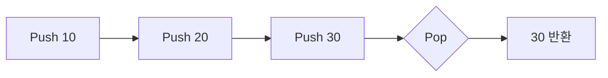
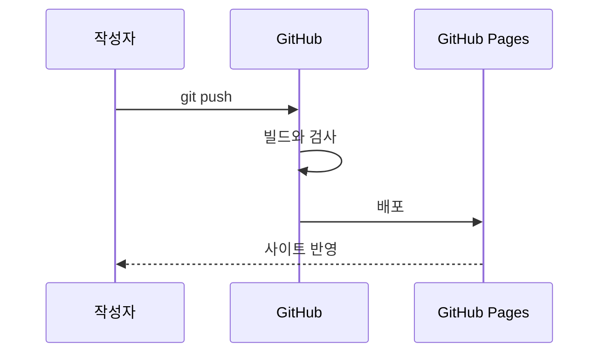

> 본문을 쓰다가 문법이 기억나지 않을 때 찾아보는 글이다. 모든 항목을 **작성 예시**와 **실제 결과**로 나란히 보여 준다.

이 블로그의 마크다운은 **kramdown**(GFM 방식)이 변환하고, 그 위에 Chirpy 테마가 안내 상자·코드 블록 헤더·이미지 처리 같은 기능을 덧붙인다. 그래서 일반적인 마크다운과 조금 다른 부분이 있다.

글의 파일 이름과 Front Matter는 [2편](/posts/chirpy-guide-2-writing-posts/)에서, 이미지와 영상은 [4편](/posts/chirpy-guide-4-images-and-media/)에서 다룬다.

---

## 1. 제목 {#headings}

```markdown
## 큰 제목 (h2)
### 중간 제목 (h3)
#### 작은 제목 (h4)
```
{: .nolineno }

- `#`(h1)은 글 제목이 사용하므로 **본문은 `##`부터** 시작한다.
- 우측 목차에는 `h2`~`h4`가 표시된다.
- 제목에 마우스를 올리면 나타나는 `#` 아이콘은 그 제목으로 바로 가는 링크이다. 글의 특정 위치를 공유할 때 쓴다.

### 1.1 제목에 ID 지정하기

제목마다 링크용 ID가 자동으로 만들어진다. 한글 제목은 ID에도 한글이 그대로 들어가므로, 글 안에서 링크를 걸 제목에는 **영문 ID를 직접 지정**하는 편이 안전하다.

```markdown
## 1. 제목 {#headings}

[제목 섹션으로 이동](#headings)
```
{: .nolineno }

결과: [제목 섹션으로 이동](#headings)

### 1.2 목차에서 제외하기

제목 바로 다음 줄에 `data-toc-skip`을 붙이면 목차에 나타나지 않는다.

```markdown
### 목차에 나타나지 않는 제목
{: data-toc-skip='' }
```
{: .nolineno }

### 목차에 나타나지 않는 제목
{: data-toc-skip='' }

---

## 2. 문단과 줄바꿈

```markdown
첫 번째 문단이다.
엔터 한 번은 줄바꿈이 되지 않고 같은 문단으로 이어진다.

빈 줄을 하나 두면 새 문단이 된다.

문단 안에서 줄만 바꾸려면 줄 끝에 역슬래시 두 개를 붙인다.\\
이렇게 하면 같은 문단 안에서 줄이 바뀐다.
```
{: .nolineno }

첫 번째 문단이다.
엔터 한 번은 줄바꿈이 되지 않고 같은 문단으로 이어진다.

빈 줄을 하나 두면 새 문단이 된다.

문단 안에서 줄만 바꾸려면 줄 끝에 역슬래시 두 개를 붙인다.\\
이렇게 하면 같은 문단 안에서 줄이 바뀐다.

> 줄 끝에 공백 두 칸을 넣어도 줄바꿈이 되지만, 눈에 보이지 않고 편집기가 지워 버리기도 한다. 역슬래시 두 개(`\\`)를 쓰는 편이 안전하다.
{: .prompt-tip }

---

## 3. 텍스트 강조

```markdown
**굵게**, *기울임*, ***굵은 기울임***, ~~취소선~~

<kbd>Ctrl</kbd>+<kbd>C</kbd>, H<sub>2</sub>O
```
{: .nolineno }

**굵게**, *기울임*, ***굵은 기울임***, ~~취소선~~

<kbd>Ctrl</kbd>+<kbd>C</kbd>, H<sub>2</sub>O

> 강조에는 밑줄(`_`)보다 **별표(`*`)를 쓴다.**
>
> 한글은 조사가 바로 붙기 때문이다. `_강조_는`처럼 닫는 밑줄 뒤에 글자가 붙으면 강조로 인식되지 않고 밑줄이 그대로 보인다. 별표는 `*강조*는`, `**강조**는` 모두 정상적으로 동작한다.
{: .prompt-warning }

---

## 4. 목록

### 4.1 순서 없는 목록

```markdown
- 장
  - 절
    - 단락
- 다음 장
```
{: .nolineno }

- 장
  - 절
    - 단락
- 다음 장

### 4.2 순서 있는 목록

```markdown
1. 첫 번째
2. 두 번째
   - 하위 항목은 상위 항목의 글자 시작 위치에 맞춰 들여 쓴다
3. 세 번째
```
{: .nolineno }

1. 첫 번째
2. 두 번째
   - 하위 항목은 상위 항목의 글자 시작 위치에 맞춰 들여 쓴다
3. 세 번째

### 4.3 목록 안에 코드 블록 넣기

항목의 글자 시작 위치에 맞춰 들여 쓰고, 앞뒤에 빈 줄을 둔다.

````markdown
1. 저장소를 등록한다.

   ```bash
   sudo apt update
   ```

2. 패키지를 설치한다.
````
{: .nolineno }

1. 저장소를 등록한다.

   ```bash
   sudo apt update
   ```

2. 패키지를 설치한다.

### 4.4 할 일 목록

```markdown
- [ ] 작업
  - [x] 1단계
  - [x] 2단계
  - [ ] 3단계
```
{: .nolineno }

- [ ] 작업
  - [x] 1단계
  - [x] 2단계
  - [ ] 3단계

### 4.5 설명 목록

용어와 뜻을 짝지어 보여 줄 때 쓴다.

```markdown
스택
: 나중에 넣은 데이터가 먼저 나오는 자료구조

큐
: 먼저 넣은 데이터가 먼저 나오는 자료구조
```
{: .nolineno }

스택
: 나중에 넣은 데이터가 먼저 나오는 자료구조

큐
: 먼저 넣은 데이터가 먼저 나오는 자료구조

---

## 5. 인용구와 안내 상자

### 5.1 인용구

```markdown
> 이 줄은 *인용구*의 예시이다.
```
{: .nolineno }

> 이 줄은 *인용구*의 예시이다.

### 5.2 안내 상자

인용구 바로 다음 줄에 `{: .prompt-종류 }`를 붙이면 안내 상자가 된다. 종류는 네 가지이다.

```markdown
> 알아 두면 좋은 요령을 적는다.
{: .prompt-tip }

> 참고할 추가 정보를 적는다.
{: .prompt-info }

> 주의해야 할 점을 적는다.
{: .prompt-warning }

> 데이터 손실이나 보안처럼 위험한 내용을 적는다.
{: .prompt-danger }
```
{: .nolineno }

> 알아 두면 좋은 요령을 적는다.
{: .prompt-tip }

> 참고할 추가 정보를 적는다.
{: .prompt-info }

> 주의해야 할 점을 적는다.
{: .prompt-warning }

> 데이터 손실이나 보안처럼 위험한 내용을 적는다.
{: .prompt-danger }

| 종류 | 용도 |
| :-- | :-- |
| `prompt-tip` | 요령, 더 나은 방법 |
| `prompt-info` | 보충 설명, 참고 사항 |
| `prompt-warning` | 실수하기 쉬운 부분, 주의 사항 |
| `prompt-danger` | 되돌릴 수 없는 작업, 보안 위험 |

### 5.3 안내 상자 안에 여러 문단과 코드 넣기

모든 줄을 `>`로 시작하고, 빈 줄에도 `>`를 적는다.

````markdown
> 설치 후 Docker가 실행 중인지 확인한다.
>
> ```bash
> sudo systemctl status docker
> ```
>
> 실행 중이 아니면 수동으로 시작한다.
{: .prompt-info }
````
{: .nolineno }

> 설치 후 Docker가 실행 중인지 확인한다.
>
> ```bash
> sudo systemctl status docker
> ```
>
> 실행 중이 아니면 수동으로 시작한다.
{: .prompt-info }

---

## 6. 표 {#tables}

```markdown
| 자료구조 | 접근 | 삽입 |
| :-- | :--: | --: |
| 배열 | `O(1)` | `O(n)` |
| 연결 리스트 | `O(n)` | `O(1)` |
```
{: .nolineno }

| 자료구조 | 접근 | 삽입 |
| :-- | :--: | --: |
| 배열 | `O(1)` | `O(n)` |
| 연결 리스트 | `O(n)` | `O(1)` |

- 둘째 줄의 콜론 위치로 정렬을 정한다. `:--` 왼쪽, `:--:` 가운데, `--:` 오른쪽.
- 칸의 폭을 맞추려고 공백을 채울 필요는 없다.
- 표가 화면보다 넓으면 자동으로 가로 스크롤이 생긴다.
- 표 앞뒤에는 빈 줄을 둔다.

> 본문에 세로 막대(`|`)를 그대로 쓰면 그 줄이 **표로 해석될 수 있다.**
>
> 세로 막대를 글자로 쓰려면 `\|`처럼 역슬래시를 붙이거나 인라인 코드로 감싼다. 표의 칸 안에서 세로 막대를 쓸 때도 마찬가지이다.
{: .prompt-warning }

---

## 7. 링크

```markdown
[Jekyll 공식 문서](https://jekyllrb.com/docs/)

<https://jekyllrb.com>

[참조 방식 링크][jekyll]

[새 탭에서 열리는 링크](https://jekyllrb.com){: target="_blank" }

[jekyll]: https://jekyllrb.com
```
{: .nolineno }

[Jekyll 공식 문서](https://jekyllrb.com/docs/)

<https://jekyllrb.com>

[참조 방식 링크][jekyll]

[새 탭에서 열리는 링크](https://jekyllrb.com){: target="_blank" }

[jekyll]: https://jekyllrb.com

참조 방식은 주소를 문서 맨 아래에 모아 둘 수 있어서, 같은 링크를 여러 번 쓰거나 참고 자료 목록을 만들 때 편하다.

### 7.1 블로그 안의 다른 글로 링크하기

```markdown
[포스트 작성 규칙](/posts/chirpy-guide-2-writing-posts/)
```
{: .nolineno }

결과: [포스트 작성 규칙](/posts/chirpy-guide-2-writing-posts/)

- `/posts/슬러그/` 형식으로 적는다. 도메인은 적지 않는다.
- **맨 끝의 슬래시(`/`)를 빠뜨리지 않는다.**
- 존재하지 않는 글로 링크하면 배포 검사에서 실패한다. push 전에 `bash tools/test.sh`로 확인한다.

### 7.2 같은 글 안에서 이동하기

```markdown
[표 섹션으로 이동](#tables)
```
{: .nolineno }

결과: [표 섹션으로 이동](#tables)

---

## 8. 각주

```markdown
본문에 각주 표시를 넣는다[^first]. 하나 더 넣을 수도 있다[^second].

[^first]: 첫 번째 각주의 내용
[^second]: 두 번째 각주의 내용
```
{: .nolineno }

본문에 각주 표시를 넣는다[^first]. 하나 더 넣을 수도 있다[^second].

각주의 내용은 어디에 적든 **글의 맨 아래**에 모여서 표시된다. 번호는 등장 순서대로 자동으로 매겨진다.

---

## 9. 인라인 코드와 파일 경로

```markdown
명령어는 `git status`처럼 적는다.

파일 경로는 `_config.yml`{: .filepath}처럼 적는다.
```
{: .nolineno }

명령어는 `git status`처럼 적는다.

파일 경로는 `_config.yml`{: .filepath}처럼 적는다.

`{: .filepath}`는 닫는 백틱 바로 뒤에 **공백 없이** 붙인다.

---

## 10. 코드 블록 {#code-blocks}

### 10.1 언어 지정

여는 백틱 뒤에 언어를 적으면 문법 강조와 줄 번호, 복사 버튼이 붙는다.

````markdown
```python
def push(stack, value):
    stack.append(value)
    return stack
```
````
{: .nolineno }

```python
def push(stack, value):
    stack.append(value)
    return stack
```

자주 쓰는 언어 이름은 다음과 같다.

| 적는 값 | 헤더 표시 | 용도 |
| :-- | :-- | :-- |
| `bash`, `sh`, `zsh` | Shell | 셸 스크립트, 명령어 |
| `console`, `terminal` | Console, Terminal | `$` 프롬프트가 있는 터미널 화면 |
| `python`, `py` | Python | — |
| `java` | Java | — |
| `javascript`, `js` | JavaScript | — |
| `typescript`, `ts` | TypeScript | — |
| `yaml`, `yml` | YAML | 설정 파일 |
| `json`, `html`, `css`, `xml`, `toml` | 대문자로 표시 | — |
| `sql`, `dockerfile`, `nginx`, `diff` | 첫 글자만 대문자 | — |
| `markdown`, `md` | Markdown | — |
| `plaintext` | Plaintext | 강조가 필요 없는 일반 텍스트, 실행 결과 |
| `text` | Text | 위와 같지만 줄 번호가 표시된다 |

> 코드 블록에는 **항상 언어를 지정한다.** 언어를 생략하면 `plaintext`로 처리되어 문법 강조가 적용되지 않는다. 마땅한 언어가 없을 때도 `plaintext`라고 직접 적어서 의도한 것임을 드러낸다.
{: .prompt-tip }

### 10.2 줄 번호 숨기기

`plaintext`, `console`, `terminal`은 처음부터 줄 번호가 없다. 그 밖의 언어에서 줄 번호를 숨기려면 코드 블록 바로 다음 줄에 `{: .nolineno }`를 붙인다.

````markdown
```bash
sudo apt update
```
{: .nolineno }
````
{: .nolineno }

```bash
sudo apt update
```
{: .nolineno }

한두 줄짜리 명령어에는 줄 번호를 숨기는 편이 보기 좋다.

### 10.3 파일 이름 표시

헤더에 언어 대신 파일 이름을 보여 준다. 어느 파일을 고치는지 알려 줄 때 쓴다.

````markdown
```yaml
timezone: Asia/Seoul
```
{: file="_config.yml" }
````
{: .nolineno }

```yaml
timezone: Asia/Seoul
```
{: file="_config.yml" }

줄 번호 숨김과 함께 쓰려면 `{: file="_config.yml" .nolineno }`처럼 한 줄에 적는다.

### 10.4 터미널 화면

명령어와 출력 결과를 함께 보여 줄 때는 `console`을 쓴다. `$`로 시작하는 줄이 명령어로 강조된다.

````markdown
```console
$ docker run hello-world
Hello from Docker!
```
````
{: .nolineno }

```console
$ docker run hello-world
Hello from Docker!
```

### 10.5 코드 블록 안에 백틱 세 개를 보여 주기

바깥쪽을 백틱 **네 개**로 감싼다. 이 글의 작성 예시가 모두 이 방식으로 만들어졌다.

`````markdown
````markdown
```bash
echo "안쪽 코드 블록"
```
````
`````
{: .nolineno }

### 10.6 Liquid 코드 보여 주기

Jekyll은 본문의 Liquid 태그를 **실행**해 버린다. Liquid 코드를 글자 그대로 보여 주려면 둘 중 하나를 쓴다.

**방법 1.** Front Matter에 `render_with_liquid: false`를 넣는다. 글 전체에서 Liquid를 해석하지 않는다. 이 글이 이 방식을 쓰고 있다.

**방법 2.** 해당 부분만 ``와 ``로 감싼다.

````markdown

```liquid

  수식을 사용하는 글이다.

```

````
{: .nolineno }

> Jekyll의 `` 태그는 이 테마와 호환되지 않는다. 코드 블록은 항상 백틱으로 만든다.
{: .prompt-danger }

---

## 11. 수식 {#math}

Front Matter에 `math: true`를 넣은 글에서만 동작한다. 수식은 [MathJax][mathjax]가 렌더링하며 LaTeX 문법으로 적는다.

### 11.1 블록 수식

`$$`로 감싸고 **앞뒤에 빈 줄**을 둔다.

```markdown
입력 크기가 $$ n $$일 때 연산 횟수는 다음과 같다.

$$
T(n) = 3n + 2
$$
```
{: .nolineno }

입력 크기가 $$ n $$일 때 연산 횟수는 다음과 같다.

$$
T(n) = 3n + 2
$$

### 11.2 인라인 수식

문장 안에 넣는 수식은 두 가지로 쓸 수 있다.

```markdown
배열의 접근은 $$ O(1) $$, 연결 리스트의 접근은 $O(n)$이다.
```
{: .nolineno }

배열의 접근은 $$ O(1) $$, 연결 리스트의 접근은 $O(n)$이다.

| 표기 | 특징 |
| :-- | :-- |
| `$$ ... $$` | 마크다운 변환기가 수식으로 인식해서 내용을 보호한다. **권장** |
| `$ ... $` | 짧게 쓸 수 있지만 내용이 마크다운으로 먼저 해석된다 |

> `$ ... $` 안에 별표(`*`)나 세로 막대(`|`), 역슬래시 두 개(`\\`)가 들어가면 마크다운 문법으로 먼저 처리되어 수식이 깨진다.
>
> `$O(n)$`, `$n$`처럼 단순한 식에만 `$ ... $`를 쓰고, 조금이라도 복잡하면 `$$ ... $$`를 쓴다.
{: .prompt-warning }

### 11.3 수식 번호와 참조

```markdown
$$
\begin{equation}
  \sum_{n=1}^\infty \frac{1}{n^2} = \frac{\pi^2}{6}
  \label{eq:series}
\end{equation}
$$

수식 \eqref{eq:series}처럼 본문에서 번호로 참조할 수 있다.
```
{: .nolineno }

$$
\begin{equation}
  \sum_{n=1}^\infty \frac{1}{n^2} = \frac{\pi^2}{6}
  \label{eq:series}
\end{equation}
$$

수식 \eqref{eq:series}처럼 본문에서 번호로 참조할 수 있다.

### 11.4 목록 안의 수식

수식 뒤에 글이 이어지는 항목은 문장 안의 수식과 똑같이 쓰면 된다.

```markdown
- $$ O(1) $$ : 상수 시간
- $$ O(\log n) $$ : 로그 시간
- $$ O(n^2) $$ : 이차 시간
```
{: .nolineno }

- $$ O(1) $$ : 상수 시간
- $$ O(\log n) $$ : 로그 시간
- $$ O(n^2) $$ : 이차 시간

반면 항목이 **수식 하나만으로** 이루어지면 블록 수식으로 처리되어 가운데에 크게 표시된다. 다른 항목처럼 왼쪽에 작게 두려면 첫 번째 `$` 앞에 역슬래시를 붙인다.

```markdown
1. \$$ O(1) $$
2. \$$ O(\log n) $$
3. \$$ O(n^2) $$
```
{: .nolineno }

1. \$$ O(1) $$
2. \$$ O(\log n) $$
3. \$$ O(n^2) $$

> 역슬래시는 **수식만 있는 줄**에만 붙인다. 뒤에 글이 이어지는 줄에 붙이면 오히려 수식이 깨진다.
>
> 이 규칙은 목록뿐 아니라 수식 하나만 적은 문단에도 똑같이 적용된다.
{: .prompt-warning }

### 11.5 여러 줄 수식

```markdown
$$
\begin{aligned}
  T(n) &= 3n^2 + 2n + 1 \\
       &= O(n^2)
\end{aligned}
$$
```
{: .nolineno }

$$
\begin{aligned}
  T(n) &= 3n^2 + 2n + 1 \\
       &= O(n^2)
\end{aligned}
$$

---

## 12. Mermaid 다이어그램 {#mermaid}

Front Matter에 `mermaid: true`를 넣은 글에서만 동작한다. 언어를 `mermaid`로 지정한 코드 블록이 다이어그램으로 바뀐다.

````markdown

````
{: .nolineno }


순서도 외에도 시퀀스 다이어그램, 간트 차트, 클래스 다이어그램 등을 그릴 수 있다. 문법은 [Mermaid 공식 문서][mermaid]를 참고한다.



---

## 13. 그 밖의 문법

### 13.1 수평선

앞뒤에 빈 줄을 두고 하이픈 세 개를 적는다. 큰 섹션을 구분할 때 쓴다.

```markdown
---
```
{: .nolineno }

### 13.2 특수 문자를 글자 그대로 쓰기

마크다운 기호를 글자로 보여 주려면 앞에 역슬래시를 붙인다.

```markdown
\*별표\*, \_밑줄\_, \`백틱\`, \# 샵, \| 세로 막대
```
{: .nolineno }

\*별표\*, \_밑줄\_, \`백틱\`, \# 샵, \| 세로 막대

### 13.3 주석

HTML 주석은 화면에 나타나지 않는다. 나중에 채울 내용을 메모해 둘 때 쓴다.

```markdown
<!-- 이 줄은 화면에 보이지 않는다 -->
```
{: .nolineno }

---

## 14. 속성 문법 요약

`{: ... }`는 kramdown이 제공하는 속성 지정 문법이다. 이 블로그의 여러 기능이 이 문법으로 동작한다.

| 문법 | 붙이는 위치 | 효과 |
| :-- | :-- | :-- |
| `{: .prompt-tip }` 등 | 인용구 **다음 줄** | 안내 상자 |
| `{: .nolineno }` | 코드 블록 **다음 줄** | 줄 번호 숨김 |
| `{: file="경로" }` | 코드 블록 **다음 줄** | 헤더에 파일 이름 표시 |
| `{: data-toc-skip='' }` | 제목 **다음 줄** | 목차에서 제외 |
| `{#아이디}` | 제목 **같은 줄 끝** | 링크용 ID 지정 |
| `{: .filepath}` | 인라인 코드 **바로 뒤** | 파일 경로 표시 |
| `{: target="_blank" }` | 링크 **바로 뒤** | 새 탭에서 열기 |
| `{: w="700" h="400" }` 등 | 이미지 **바로 뒤** | 이미지 크기·위치 ([4편](/posts/chirpy-guide-4-images-and-media/)) |

위치에 따라 규칙이 다르다.

- 문단·인용구·코드 블록 같은 **블록 요소**에는 바로 다음 줄에 붙인다. 사이에 빈 줄이 있으면 적용되지 않는다.
- 인라인 코드·링크·이미지 같은 **인라인 요소**에는 같은 줄에서 공백 없이 바로 뒤에 붙인다.

---

## 참고 자료

- [**kramdown Syntax**][kramdown]
- [**MathJax 문서**][mathjax-docs]
- [**Mermaid 공식 문서**][mermaid]
- [**Rouge 지원 언어 목록**][rouge]

---

_`Last updated: 2026-11-17`_{: .right}

[^first]: 첫 번째 각주의 내용
[^second]: 두 번째 각주의 내용

[mathjax]: https://www.mathjax.org/
[mathjax-docs]: https://docs.mathjax.org/en/latest/
[mermaid]: https://mermaid.js.org/intro/
[kramdown]: https://kramdown.gettalong.org/syntax.html
[rouge]: https://github.com/rouge-ruby/rouge/wiki/List-of-supported-languages-and-lexers
